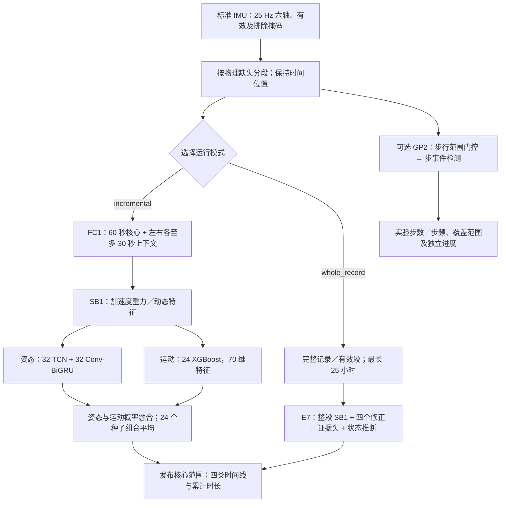
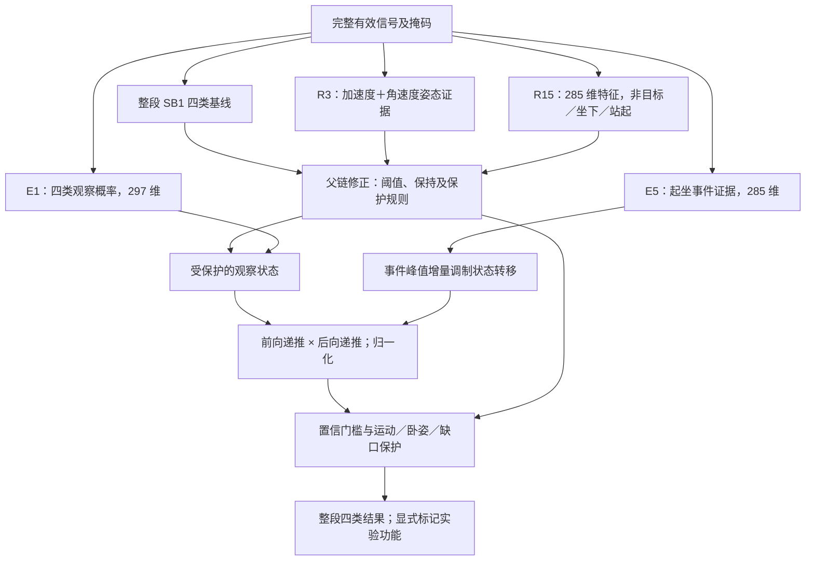

# 模型、训练与验证

适用推理库 **1.0.1**，固定权重、原生 CPU。与 1.0.0 使用同一组模型和计算算法；本次更新文档、授权声明及交付工程，不宣称提高准确率。本文是模型信息主入口，详细人员、种子、配置及结果通过文末证据追溯。

交付的可复现范围为固定权重推理和制品构建，不包含原始数据或从头重训全套模型的工程。模型表现、工程运行验证、客户准确率验收分别记录。

## 能力与运行方式

规范胸前佩戴、25 Hz 六轴；加速度 m/s²、保留重力，角速度 rad/s。SB1 使用加速度，E7 部分分支使用角速度。不能自动纠正任意佩戴或坐标变化。

| 分组 | 纳入的原始标注 |
|---|---|
| lying 卧姿相关 | 躺卧、躺下 |
| sitting 坐蹲相关 | 坐、坐下、蹲、蹲下 |
| standing 站姿与起身相关 | 站、弯腰/拾取、站起、起身 |
| walking_running 行进及跳跃相关 | 步行、跑步、上下楼、跳跃 |

无独立可靠的走跑二分类、跌倒、睡眠或疾病诊断。活动段数也不能当作起坐次数。

| 模式 | 模型与计算 | 输出时间 |
|---|---|---|
| incremental，默认 | SB1 FINAL + FC1 L60/H30；60 秒核心，左右各至多 30 秒上下文 | 正常累计 90 秒后输出首个核心，之后每 60 秒推进；结束处理尾段 |
| whole_record，实验 | E7 HARD_POSITIVE / smoothed / seed 2026102531；完整有效段与前后向状态证据 | 完整记录计算成功后输出，最长 25 小时 |

包长与算法核心独立；整段可以是短录制，不强制等一天。E7 分块独立计算后拼接，不等价于已验证整段计算。一个任务只选择一种模式。

“90 秒”是默认无缺失情况下产生首个分类核心所需的数据长度，不是上传包规格，也不是神经网络窗口。TCN 感受野、BiGRU 裁剪、FC1 核心及上下文是不同层次的长度。末尾由 `finish` 收尾；缺失或排除范围不能假定为某种动作。

## 模型与训练算法

SB1 包含 **32 个 TCN、32 个 Conv-BiGRU、24 个 XGBoost**，共 88 个唯一成员；神经参数 **10,682,624**，不含树节点与 GP2。每个 worker 加载复用模型，不是 88 个服务进程。

三轴加速度先经二阶 0.3 Hz Butterworth 前后向低通估计重力，再生成 8 维重力方向、动态分量和变化率特征。TCN 的膨胀卷积/残差提取短时模式，理论感受野 5 秒；Conv-BiGRU 结合卷积与双向 GRU，完整推理裁剪约 25.32 秒。缺失处断开，不跨缺口滤波。

运动树使用 70 维统计、FFT 和自相关特征，得到运动概率 w；姿态组输出归一化的卧/坐/站概率 s，组合为 `[(1-w)s卧,(1-w)s坐,(1-w)s站,w]`，再按固定姿态组和 24 个种子融合，不是 88 个成员简单投票。

神经训练使用有效标注上的加权交叉熵、AdamW（学习率 0.001，weight decay 0.0001，batch 64），中央 125 个位置监督；幅度、上下文拼接及部分速度/方向增强。新增 TCN / BiGRU 每成员固定 704 / 3,712 次更新；运动树 depth 6，每成员抽取 300,000 个中心，785 轮。

| 结构／训练项 | TCN | Conv-BiGRU |
|---|---|---|
| 结构 | 8→64 投影；7 层 kernel=5 膨胀卷积，dilation=[1,2,4,4,4,8,8]；GELU、残差；64→4 | 4 层 kernel=5、64 通道卷积；2 层 hidden=64 双向 GRU；128→4 |
| 单成员神经参数 | 144,644 | 189,188 |
| 新成员训练裁剪 | 249 点，约 9.96 秒 | 633 点，约 25.32 秒 |
| 监督／梯度 | 中央 125 点与有效标注 mask；norm clip=5 | 同左，另按样本出现类别归一化损失 |

其中 16 个旧神经成员（N 组）直接继承，按公开开发损失选 checkpoint；新增 L/G 各 24 个成员按固定更新数训练。不能将全部 64 个成员说成同一种重训。增强包括动态幅度、部分外围上下文替换；G 组另有速度和至多 25° 重力方向扰动。拼接接缝不监督，增强不构成任意佩戴兼容承诺。

运动树 PM 使用 `binary:logistic`、hist、eta=0.05、min_child_weight=10、lambda=1、subsample=0.8、colsample_bytree=0.8。采样配方为基础公共池 60%、WISDM 手机 20%、MotionSense 20%，平衡运动与非运动；30 万个中心含重复采样，不等于独立动作数。MHEALTH 弯腰还以 0.25 权重提供站姿相关弱监督，应与直接姿态真值区分。

融合先对 N/L/G 姿态组组合，再对 24 个种子组合平均；共享 N 组只计算和复用一次。种子 20261024～20261047 分成前后各 12 个的 ALPHA/BETA，FINAL 使用全部 24 个。两组共享 N 权重和来源，不是全链独立训练的两次实验。成员没有按人员身份或真实动作标签选择性激活。

E7 在整段 SB1 上增加 R3 六轴姿态修正、R15 起坐方向证据、E1 四类观察头和 E5 起坐事件头，共 4 个 XGBoost。E1 / E5 分别 297 / 285 维、450 / 350 轮。事件证据调制状态转移，前向利用过去、后向利用未来，得到平滑状态概率，在保护规则内修正坐站。不是简单滑动平均，也不使用人员 ID 或真值推理。

E1 为 depth=6 的四分类 `multi:softprob`；E5 为 depth=4 的三分类头。两者 eta=0.05、min_child_weight=10、lambda=10、subsample=0.8、colsample_bytree=0.85。E1 的原数据／Elder 增量损失质量为 80%／20%；E5 非目标／坐下／站起为 50%／25%／25%。比例指训练损失质量，不是采集时长。

E7 交付链使用种子 2026102531，不做双种子平均。E5 门槛 0.85 以上的证据按同一事件片段的新峰值增量影响转移，避免重复累加同一次动作；观察概率以 0.05 幂次加权，平滑后按 0.9 门槛等规则覆盖允许的坐站位置。局部积分提供过渡线索，不代表可靠空间位移。末端保护卧姿也不能保证整条 E7 相对 FC1 的卧姿结果不变，因为上游上下文和修正已不同。

加速度的重力方向与运动周期性支持粗分类；胸前直立坐姿和站姿信号相近，是主要困难。E7 同时改变数据、分支和状态算法，其收益不能全部归因于增加角速度。纵向符号适配为实验功能，默认关闭，不等于三维佩戴校准。

公共六轴数据并非唯一瓶颈：传感器位置、过渡标注、单位和可用通道同样重要。例如 MHEALTH 胸部提供加速度及 ECG，其其他位置的角速度不能冒充胸部角速度。要量化六轴的独立收益，需固定数据、人员划分、容量和后处理，只改变模态做消融；当前 E7/FC1 对比不具备这个因果解释。

## 实际使用的数据规模与划分

SB1 七个公共来源的训练人员并集为 **108 人**。下表是项目实际分支用量，不是各公共数据集全部规模。

| 来源 | 新姿态 L/G 每成员人数 | 运动树 PM 每成员人数 |
|---|---:|---:|
| HAPT | — | 16 |
| HARTH | 17 | 14 |
| MHEALTH | 9 | 7 |
| MotionSense | — | 17 |
| Opportunity | 3 | 2 |
| PAMAP2 | 6 | 4 |
| WISDM 2019 | — | 40 |
| 分支合计 | 35 | 100 |

另继承 16 个神经成员，每成员 27 人，来自 HARTH/MHEALTH/Opportunity/PAMAP2。不同分支人员有重叠，不可相加。PAMAP2/MHEALTH 使用项目采纳的胸部通道；腰背和手机来源存在位置差异，手机主要补充运动判别。

| E7 分支 | 公共训练来源与人数 | 本分支保留人数 |
|---|---|---:|
| R3 | HAPT 21、HARTH 17、MHEALTH 9、Opportunity 3、PAMAP2 6，共 56 | 12 |
| R15 | R3 的 56 人 + FORTH-TRACE 11、UniPD 12，共 79 | 22 |
| E1 | ElderHAR 43、FORTH-TRACE 11、HAPT 14、MHEALTH 9、Opportunity 3、PAMAP2 6、UniPD 12，共 98 | 34 |
| E5 | ElderHAR 43、FORTH-TRACE 11、HAPT 14、Mendeley ADL 8，共 76 | 36 |

E1/E5 分别使用 359,927 / 260,550 个训练中心。中心不是独立动作，分支人数不能相加；没有把公共库完整时长冒充实际训练时长。

按来源、人员清单划分，不是随机窗口 80/20。旧 SB1 开发池部分人员后来进入最终训练；E1 保留的 7 位 HAPT 人员已在 R3/R15 训练，因此分支保留人数不等于整条管线未见人数。

UniPD 是 UNIPD-BPE 的实测 IMU 视图，其部分起坐监督由作者全身运动学生成弱标签；不作为人工逐帧金标准。FORTH 使用通过时钟检查的连续范围和无量纲加速度特征；未知、边界不可靠的标签不补作背景。ElderHAR、Mendeley ADL 均为公共来源，不是本公司的自采数据。官方来源及其版本见 [数据来源与授权核对](sources-and-licenses.md)。

分类评估来自自采胸前 **9 人、23 条短录制**：原始约 **140.55 分钟**，有标注评分范围 **184,383 个 25 Hz 位置，即 122.922 分钟、816 个 ES1 区间**。自采数据没有进入权重、归一化拟合或伪标签训练，但反复用于比较和选择，因此不是独立客户盲测。公共训练数据同样是真实 IMU 测量。

## 分类和时长指标

ES1 合并相邻同类有效标注。一个区间中，正确类别必须覆盖有效标注时间严格超过 50% 才计对；平票、未知和不足半数计错。Accuracy 为判对区间/全部区间；macro recall 为四类召回等权平均；macro precision 为四类精确率等权平均。

先在每个标注区间确定预测类别，再按冻结评分器形成包含 unknown 的混淆计数。`recall_c=TP_c/(TP_c+FN_c)`，`precision_c=TP_c/(TP_c+FP_c)`；macro 是四个类别指标的算术平均，accuracy 则是所有区间合并后的正确比例。逐帧 accuracy 以有效标注采样位置为单位，长动作影响更大。它们分母、权重不同，不能互换名称。

| 同一研究参考 | FC1 分块 | E7 整段，符号适配关闭 |
|---|---:|---:|
| ES1 macro recall，主分类指标 | 67.72% | 74.09% |
| ES1 accuracy | 593/816 = 72.67% | 616/816 = 75.49% |
| ES1 macro precision | 74.58% | 75.24% |
| 逐帧 accuracy | 70.97% | 72.69% |
| 人均四类时长占比 MAE | 5.532 pp | 5.181 pp |

时长用途先合并每个人全部录制，在相同评分位置计算各类真值 T、预测 P：带方向误差为 `100(P-T)/T`，绝对相对误差为 `100|P-T|/T`。各类按参与者等权平均，T=0 记 N/A 并另列误报时长。以下四类各有 9 位有效参与者：

| 参与者累计时长平均绝对相对误差 | FC1 | E7 |
|---|---:|---:|
| 卧姿相关 | 48.11% | 64.89% |
| 坐蹲相关 | 47.04% | 25.35% |
| 站姿与起身相关 | 20.05% | 20.15% |
| 行进及跳跃相关 | 15.12% | 14.96% |

E7 坐蹲改善明显，但卧姿时长误差变大；短真值会放大百分比。累计时长误差可相互抵消，不能换算为 100%-误差 的准确率。时长占比误差分母为个人总评分时长，单位 pp，与逐类相对误差不同。

产品以时长统计为目的时，优先查看逐人逐类相对误差，同时查看带方向误差、原始真值时长和逐帧混淆。不能先把所有参与者混在一起再求差：不同人的高估与低估也会抵消。合并一个人多条录制同样可能抵消录制间误差，因此还需按录制诊断。当前参考是短录制，不能直接外推全天时长可靠性。逐人表保留 unikey，原始信号不随包分发。

历史 579/720=80.42% 采用不同范围与“唯一最多票”，不是严格过半；不能当作当前 ES1、逐帧结果或新客户保底值。SB1 原重复验收也未全部通过，仍保持冻结有限发布边界。

## GP2 与性能

GP2 用 31 维加速度特征的梯度提升模型筛选步行范围，再用 Shin norm 检测器找步事件；4 秒门控上下文、30 秒核心与左右 2 秒上下文，缺失处断开。默认开启、可关闭，始终为实验功能。

门控为 `HistGradientBoostingClassifier`，150 iterations、depth=4、最多 15 leaves，每秒计算步行候选，门槛 0.5；检测器为冻结的 `mobgap.IcdShinImproved(axis='norm')`。只保留核心内步事件并去重；不足 4 秒的片段可能无法分析，应保持 null 或覆盖不足，不当作零步。分类与计步独立，不从活动片段数推断起坐次数。

OxWalk 髋部保留评估为 **15 人、14.94 小时、27,631 个参考步**。记录总步数 MAPE 6.14%，10 秒计数误差 23.40%，非步行误检约 50.8 步/小时；1～5 步短段误差约 67.31%。步事件 F1 按评分更正约 56.29%。没有本设备胸部独立步事件金标准，不应声称每步正确率 93.86%。

旧版 1.0.0 wheel 约 59.54 MiB；新包实际字节数由新 Release 清单提供，不能把包体积当作内存。既有共享 Ryzen 5 7500F、2 CPU/2 线程的单任务测试：E7+GP2 处理 24 小时合成输入约 53.99 分钟，峰值 RSS 3.790 GiB；25 小时约 60.37 分钟、4.007 GiB。不含上传排队，合成信号未触发步事件，不是全天准确率、最坏负载或持续吞吐保证。每个 worker 加载自身实例；进程副本和队列影响服务总内存，不能用单实例峰值代表整机。

## 证据和适用边界

88 个 SB1 成员与 4 个 E7 模型均核对训练摘要。固定权重和处理链可重现参考输出。客户验收仍需冻结方案后使用新人员、实际设备和目标场景，重点检查坐站、稀少卧姿、过渡、缺失及长时间覆盖，并约定逐类时长容差。

原生文件为 .pt/.ubj/.joblib，ONNX 未替代完整管线。自有代码采用 MIT；R15、E1、E5 权重采用 CC BY-SA 4.0，其余可授权自有权重采用 MIT，第三方条款保留。R15 历史 research_only 标记保留用于追溯，当前发布范围与来源署名见 [模型许可](../MODEL_LICENSES.md) 和 [发布许可记录](../provenance/source-license-review.json)。本次许可决定没有改变权重、算法或精度证据。

固定权重复现：按仓库锁文件安装 CPU 依赖，运行 `examples/streaming.py` 或服务接口样例；执行现有模型测试验证管线。独立复算研究准确率需要被授权访问原始信号和标注，汇总 CSV 只足以复核聚合公式。运行依赖、更新和验收入口见 [README](../README.md)，原始信号和完整研究训练工程不在交付范围。

证据：[SB1 训练审计](../provenance/sb1-training-audit.json)、[E7 来源审计](../provenance/e7-training-sources.json)、[分类参考](../provenance/dual-mode-reference.json)、[逐人时长 JSON](../provenance/participant-duration.json)、[CSV](../provenance/participant-duration.csv)。复算脚本需有权访问对应原始输入；原始数据不随包分发。
